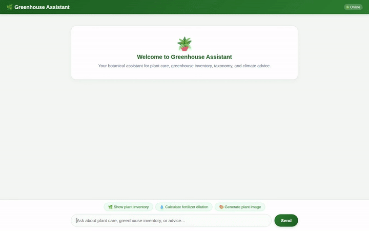

# 🌿 Greenhouse Assistant

An intelligent, multimodal botanical and greenhouse management agent built with Google Agent Development Kit (ADK), Gemini 3.8 Flash, and Google Cloud services.



---

## Overview

**Greenhouse Assistant** assists greenhouse managers, botanists, and indoor plant hobbyists in maintaining plant health, managing inventory, tracking allergies, and generating visual content. It features a conversational chat frontend powered by FastAPI and the Agent-to-Agent (A2A) protocol, rendering rich A2UI cards alongside conversational text.

---

## Key Features & Wired Services

- **Cross-Session Memory (Vertex AI Memory Bank)**:
  - Uses `VertexAiMemoryBankService` and `PreloadMemoryTool` to remember user preferences, indoor lighting conditions, and critical pollen/plant allergies across sessions.
- **Real-Time Inventory Database (Google Cloud Firestore)**:
  - Directly queries and updates plant inventory (`list_inventory`, `get_plant_details`, `update_plant_stock`, `add_plant_to_inventory`).
- **Python Code Execution (Agent Engine Sandbox)**:
  - Uses `AgentEngineSandboxCodeExecutor` to safely execute Python computations for fertilizer dilution ratios, watering volume calculations, and environmental metrics.
- **Multimodal Media Generation (Imagen & Omni)**:
  - **Image Generation**: Generates botanical images via `gemini-3.1-flash-lite-image`.
  - **Video Generation**: Creates short cinematic botanical clips via Google's Omni model (`gemini-omni-flash-preview`).
  - **Public Media Storage**: Uploads all generated images and videos directly to a public Google Cloud Storage bucket and saves them as session artifacts.
- **Rich Display UI (A2UI)**:
  - Emits A2UI structured cards, columns, rows, and images for clean tabular data and inventory listings.
- **Live Botanical & Location Context**:
  - Weather simulation for greenhouse ambient conditions (`get_live_weather`).
  - Taxonomic family classification search (`lookup_botanical_taxonomy`).
  - Google Maps geocoding and nearby nursery discovery (`geocode_address`, `find_nearby_places`).

---

## Project Structure

```
.
├── app/
│   ├── agent.py              # Root ADK agent, callbacks, and tool configuration
│   ├── firestore_tools.py    # Firestore CRUD operations for plant inventory
│   ├── image_tools.py        # Gemini 3.1 Flash Lite Image generation tool
│   ├── video_tools.py        # Gemini Omni Flash Preview video generation tool
│   ├── weather_tools.py      # Greenhouse climate and weather simulation
│   ├── botanical_tools.py    # Botanical taxonomy lookup
│   ├── maps_tools.py         # Google Maps geocoding & nearby places lookup
│   └── a2ui_utils.py         # A2UI response formatting callback
├── frontend/
│   ├── main.py               # FastAPI proxy bridging A2A protocol to browser
│   ├── static/
│   │   └── index.html        # Custom chat frontend with A2UI renderer
│   ├── Dockerfile            # Cloud Run container definition
│   └── requirements.txt      # Frontend dependencies
├── agents-cli-manifest.yaml   # Agent deployment manifest
├── greenhouse_demo.webm      # Recorded raw screen capture
├── demo.gif                  # Looping demo animation
└── README.md
```

---

## Local Setup & Running Instructions

### Prerequisites
- Python 3.11+
- Google Cloud SDK (`gcloud`) authenticated with a project having Vertex AI, Firestore, and Cloud Storage APIs enabled.

### 1. Run the Agent Locally
```bash
# In the project root directory
python3 -m venv .venv
source .venv/bin/activate
pip install -r requirements.txt

# Run the agent with ADK Web / Playground
adk web app
```

### 2. Run the Custom Chat Frontend
```bash
# In a separate terminal tab
cd frontend
python3 -m venv .venv
source .venv/bin/activate
pip install -r requirements.txt

# Start the frontend proxy
python main.py
```
Open your browser to port 8080 to interact with the full Greenhouse Assistant interface.
